<div align="center">
  
</div>

<div align="center">
  
</div>

<p align="center">
  <a href="https://github.com/intersecato/intersecato/actions">
    
  </a>
  <a href="https://github.com/intersecato/intersecato/actions">
    
  </a>
  <a href="https://github.com/intersecato/intersecato/actions">
    
  </a>
  <a href="https://github.com/intersecato/intersecato/actions">
    
  </a>
</p>

---

<div align="center">
  
  
</div>

<br/>

<div align="center">
  <a href="https://t.me/intersecato" target="_blank">
    
  </a>
  <a href="https://instagram.com/niccolo.pedrinii" target="_blank">
    
  </a>
  <a href="mailto:business@intersecato.it">
    
  </a>
</div>

---

### 👨‍💻 About Me

```yaml
name: Niccolò Pedrini
from: Bergamo (Italy)
job: Engineering student
education: ["Scientific High School"]
fields_of_interests: ["Software Engineering", "Aerospace & Space", "Web Technologies", "Simulation & Modeling"]
technical_background: ["Python", "Node.js", "React", "Java"]
currently_learning: ["Advanced Frontend", "Backend Systems", "Cloud Infrastructure"]
will_learn: ["Scalable Backend Systems", "Embedded Development", "Aerospace Software"]
hobbies: ["Flight Simulators", "Gaming", "Tech & Innovation"]
```

### 🛠️ Languages & Technologies

<div align="center">
  <a href="https://skillicons.dev">
    
  </a>
</div>

---

### 📈 Contribution Graph

<div align="center">
  
</div>

---

### 🎵 What I'm Listening To

<div align="center">
  <table border="0">
    <tr>
      <td align="center" valign="middle">
        
      </td>
      <td align="center" valign="middle">
        
      </td>
    </tr>
  </table>
</div>

---

### ⚡ Recent Activity

<!--START_SECTION:activity-->
1. 💪 Opened PR [#3726](https://github.com/IntellectualSites/FastAsyncWorldEdit/pull/3726) in [IntellectualSites/FastAsyncWorldEdit](https://github.com/IntellectualSites/FastAsyncWorldEdit)
2. 🎉 Merged PR [#2328](https://github.com/EngineHub/WorldGuard/pull/2328) in [EngineHub/WorldGuard](https://github.com/EngineHub/WorldGuard)
3. 🎉 Merged PR [#3714](https://github.com/IntellectualSites/FastAsyncWorldEdit/pull/3714) in [IntellectualSites/FastAsyncWorldEdit](https://github.com/IntellectualSites/FastAsyncWorldEdit)
4. 🗣 Commented on [#3714](https://github.com/IntellectualSites/FastAsyncWorldEdit/pull/3714#issuecomment-6691107837) in [IntellectualSites/FastAsyncWorldEdit](https://github.com/IntellectualSites/FastAsyncWorldEdit)
5. 🚀 Published release [0.10.1](https://github.com/CoralRP/AtlantisUpdates/releases/tag/v0.10.1) in [CoralRP/AtlantisUpdates](https://github.com/CoralRP/AtlantisUpdates)
<!--END_SECTION:activity-->

---

### 📊 Coding Metrics & Stats

<!--START_SECTION:waka-->


**🐱 My GitHub Data** 

> 📦 652.0 kB Used in GitHub's Storage 
 > 
> 🏆 11,167 Contributions in the Year 2026
 > 
> 💼 Opted to Hire
 > 
> 📜 20 Public Repositories 
 > 
> 🔑 46 Private Repositories 
 > 
**I'm a Night 🦉** 

```text
🌞 Morning                4657 commits        ██░░░░░░░░░░░░░░░░░░░░░░░   09.37 % 
🌆 Daytime                11940 commits       ██████░░░░░░░░░░░░░░░░░░░   24.01 % 
🌃 Evening                7446 commits        ████░░░░░░░░░░░░░░░░░░░░░   14.97 % 
🌙 Night                  25680 commits       █████████████░░░░░░░░░░░░   51.65 % 
```


📊 **This Week I Spent My Time On** 

```text
🕑︎ Time Zone: Europe/Rome

💬 Programming Languages: 
Other                    13 hrs 13 mins      ████████░░░░░░░░░░░░░░░░░   31.42 % 
Java                     12 hrs 21 mins      ███████░░░░░░░░░░░░░░░░░░   29.37 % 
YAML                     5 hrs 47 mins       ███░░░░░░░░░░░░░░░░░░░░░░   13.75 % 
TypeScript               3 hrs 16 mins       ██░░░░░░░░░░░░░░░░░░░░░░░   07.76 % 
Python                   1 hr 35 mins        █░░░░░░░░░░░░░░░░░░░░░░░░   03.78 % 

🐱‍💻 Projects: 
configs                  6 hrs 30 mins       ████░░░░░░░░░░░░░░░░░░░░░   15.46 % 
website                  4 hrs 39 mins       ███░░░░░░░░░░░░░░░░░░░░░░   11.08 % 
roleplay)                2 hrs 57 mins       ██░░░░░░░░░░░░░░░░░░░░░░░   07.04 % 
zombie-module            2 hrs 47 mins       ██░░░░░░░░░░░░░░░░░░░░░░░   06.62 % 
AtlantisRP               2 hrs 15 mins       █░░░░░░░░░░░░░░░░░░░░░░░░   05.36 % 
```


 Last Updated on 11/11/2026 19:54:36 UTC
<!--END_SECTION:waka-->

<!--START_SECTION:wakasimple-->

```txt
From: 06 April 2026 - To: 10 November 2026

Total Time: 832 hrs 48 mins

Java              375 hrs 34 mins       ⣿⣿⣿⣿⣿⣿⣿⣿⣿⣿⣿⣤⣀⣀⣀⣀⣀⣀⣀⣀⣀⣀⣀⣀⣀   45.10 %
Other             115 hrs 16 mins       ⣿⣿⣿⣦⣀⣀⣀⣀⣀⣀⣀⣀⣀⣀⣀⣀⣀⣀⣀⣀⣀⣀⣀⣀⣀   13.84 %
YAML              78 hrs 38 mins        ⣿⣿⣤⣀⣀⣀⣀⣀⣀⣀⣀⣀⣀⣀⣀⣀⣀⣀⣀⣀⣀⣀⣀⣀⣀   09.44 %
TypeScript        71 hrs 4 mins         ⣿⣿⣄⣀⣀⣀⣀⣀⣀⣀⣀⣀⣀⣀⣀⣀⣀⣀⣀⣀⣀⣀⣀⣀⣀   08.53 %
JSON              28 hrs 40 mins        ⣷⣀⣀⣀⣀⣀⣀⣀⣀⣀⣀⣀⣀⣀⣀⣀⣀⣀⣀⣀⣀⣀⣀⣀⣀   03.44 %
```

<!--END_SECTION:wakasimple-->

<div align="center">
  
</div>
