<div align="center">
  
</div>

<div align="center">
  
</div>

<p align="center">
  <a href="https://github.com/intersecato/intersecato/actions">
    
  </a>
  <a href="https://github.com/intersecato/intersecato/actions">
    
  </a>
  <a href="https://github.com/intersecato/intersecato/actions">
    
  </a>
  <a href="https://github.com/intersecato/intersecato/actions">
    
  </a>
</p>

---

<div align="center">
  
  
</div>

<br/>

<div align="center">
  <a href="https://t.me/intersecato" target="_blank">
    
  </a>
  <a href="https://instagram.com/niccolo.pedrinii" target="_blank">
    
  </a>
  <a href="mailto:business@intersecato.it">
    
  </a>
</div>

---

### 👨‍💻 About Me

```yaml
name: Niccolò Pedrini
from: Bergamo (Italy)
job: Engineering student
education: ["Scientific High School"]
fields_of_interests: ["Software Engineering", "Aerospace & Space", "Web Technologies", "Simulation & Modeling"]
technical_background: ["Python", "Node.js", "React", "Java"]
currently_learning: ["Advanced Frontend", "Backend Systems", "Cloud Infrastructure"]
will_learn: ["Scalable Backend Systems", "Embedded Development", "Aerospace Software"]
hobbies: ["Flight Simulators", "Gaming", "Tech & Innovation"]
```

### 🛠️ Languages & Technologies

<div align="center">
  <a href="https://skillicons.dev">
    
  </a>
</div>

---

### 📈 Contribution Graph

<div align="center">
  
</div>

---

### 🎵 What I'm Listening To

<div align="center">
  <table border="0">
    <tr>
      <td align="center" valign="middle">
        
      </td>
      <td align="center" valign="middle">
        
      </td>
    </tr>
  </table>
</div>

---

### ⚡ Recent Activity

<!--START_SECTION:activity-->
1. 🎉 Merged PR [#3730](https://github.com/IntellectualSites/FastAsyncWorldEdit/pull/3730) in [IntellectualSites/FastAsyncWorldEdit](https://github.com/IntellectualSites/FastAsyncWorldEdit)
2. 🎉 Merged PR [#3733](https://github.com/IntellectualSites/FastAsyncWorldEdit/pull/3733) in [IntellectualSites/FastAsyncWorldEdit](https://github.com/IntellectualSites/FastAsyncWorldEdit)
3. 💪 Opened PR [#387](https://github.com/FancyInnovations/FancyPlugins/pull/387) in [FancyInnovations/FancyPlugins](https://github.com/FancyInnovations/FancyPlugins)
4. 🎉 Merged PR [#3728](https://github.com/IntellectualSites/FastAsyncWorldEdit/pull/3728) in [IntellectualSites/FastAsyncWorldEdit](https://github.com/IntellectualSites/FastAsyncWorldEdit)
5. 🗣 Commented on [#3731](https://github.com/IntellectualSites/FastAsyncWorldEdit/pull/3731#issuecomment-6896739028) in [IntellectualSites/FastAsyncWorldEdit](https://github.com/IntellectualSites/FastAsyncWorldEdit)
<!--END_SECTION:activity-->

---

### 📊 Coding Metrics & Stats

<!--START_SECTION:waka-->


**🐱 My GitHub Data** 

> 📦 652.1 kB Used in GitHub's Storage 
 > 
> 🏆 11,834 Contributions in the Year 2026
 > 
> 💼 Opted to Hire
 > 
> 📜 14 Public Repositories 
 > 
> 🔑 46 Private Repositories 
 > 
**I'm a Night 🦉** 

```text
🌞 Morning                4686 commits        ██░░░░░░░░░░░░░░░░░░░░░░░   09.35 % 
🌆 Daytime                12045 commits       ██████░░░░░░░░░░░░░░░░░░░   24.04 % 
🌃 Evening                7483 commits        ████░░░░░░░░░░░░░░░░░░░░░   14.93 % 
🌙 Night                  25899 commits       █████████████░░░░░░░░░░░░   51.68 % 
```


📊 **This Week I Spent My Time On** 

```text
🕑︎ Time Zone: Europe/Rome

💬 Programming Languages: 
Other                    12 hrs 33 mins      ████████░░░░░░░░░░░░░░░░░   33.76 % 
Java                     10 hrs 47 mins      ███████░░░░░░░░░░░░░░░░░░   29.02 % 
YAML                     2 hrs 44 mins       ██░░░░░░░░░░░░░░░░░░░░░░░   07.35 % 
TypeScript               2 hrs 36 mins       ██░░░░░░░░░░░░░░░░░░░░░░░   07.00 % 
Text                     1 hr 53 mins        █░░░░░░░░░░░░░░░░░░░░░░░░   05.10 % 

🐱‍💻 Projects: 
hospital-module          3 hrs 34 mins       ██░░░░░░░░░░░░░░░░░░░░░░░   09.61 % 
website                  3 hrs 30 mins       ██░░░░░░░░░░░░░░░░░░░░░░░   09.42 % 
roleplay)                3 hrs 17 mins       ██░░░░░░░░░░░░░░░░░░░░░░░   08.87 % 
configs                  2 hrs 56 mins       ██░░░░░░░░░░░░░░░░░░░░░░░   07.92 % 
Directory di lavoro remot1 hr 57 mins        █░░░░░░░░░░░░░░░░░░░░░░░░   05.26 % 
```


 Last Updated on 22/11/2026 19:40:23 UTC
<!--END_SECTION:waka-->

<!--START_SECTION:wakasimple-->

```txt
From: 06 April 2026 - To: 21 November 2026

Total Time: 905 hrs 10 mins

Java              395 hrs 56 mins       ⣿⣿⣿⣿⣿⣿⣿⣿⣿⣿⣿⣀⣀⣀⣀⣀⣀⣀⣀⣀⣀⣀⣀⣀⣀   43.74 %
Other             139 hrs 44 mins       ⣿⣿⣿⣷⣀⣀⣀⣀⣀⣀⣀⣀⣀⣀⣀⣀⣀⣀⣀⣀⣀⣀⣀⣀⣀   15.44 %
YAML              84 hrs 17 mins        ⣿⣿⣤⣀⣀⣀⣀⣀⣀⣀⣀⣀⣀⣀⣀⣀⣀⣀⣀⣀⣀⣀⣀⣀⣀   09.31 %
TypeScript        73 hrs 44 mins        ⣿⣿⣀⣀⣀⣀⣀⣀⣀⣀⣀⣀⣀⣀⣀⣀⣀⣀⣀⣀⣀⣀⣀⣀⣀   08.15 %
JSON              33 hrs 3 mins         ⣷⣀⣀⣀⣀⣀⣀⣀⣀⣀⣀⣀⣀⣀⣀⣀⣀⣀⣀⣀⣀⣀⣀⣀⣀   03.65 %
```

<!--END_SECTION:wakasimple-->

<div align="center">
  
</div>
